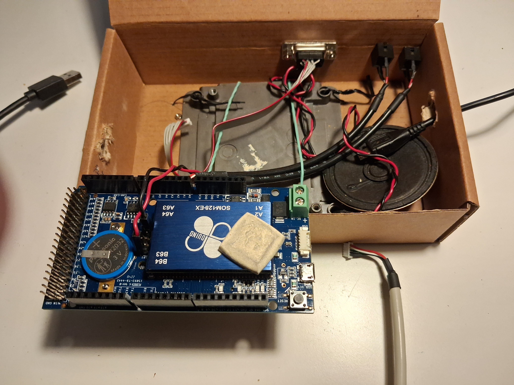
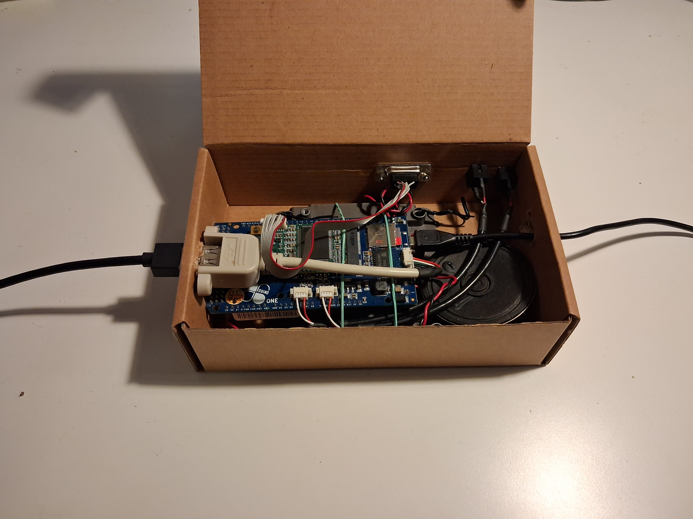
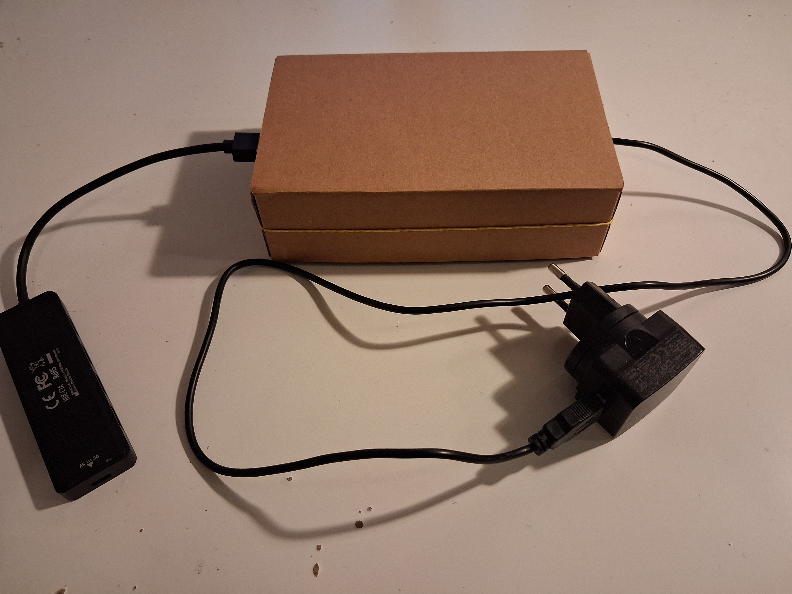

# 86Duino, my retro gaming PC to play my 50+40 favourite MSDOS games

## Introduction

I grew up in the 90s which explains why I enjoy playing with MSDOS games: it
brings me back to my childhood. I wanted to build something like a 486 gaming
PC for a long time, however, one day YouTube recommended me an LGR video about
the PixelX86 project - the background of that is that some companies are still
manufacturing X86 processors to this present day, mostly for embedded systems
(to keep things like old industrial metal cutters and ATM machines running), and
some Englishmen had the brilliant idea to pack those hardwares in a shiny metal
box and to sell it together with a bunch of old Windows98 and MSDOS games.
Learning about that really made me thinking, especially about what is important
to me and what is not and how could I maximize my nostalgia, so at that point
I sat down and I wrote a list to myself to outline what kind of retro gaming
PC I want to build.

My contraints for my retro PC build were:
1.  I definitely want to run the original old games on real X86 hardware. No
    emulation, no browser games, no ports to newer architecture, etc.
    It is just very disappointing when after an Alt+Tab I find myself in
    the present day - I want to go into an isolated room with a piece of
    hardware which is doomed by very similar limitations like the ones we had
    back then.
2.  Although I feel nostalgia for MSDOS games, I have no nostalgia for retro
    hardware. PCs back then were bulky, noisy, consumed a lot of electricity,
    heated the room up, the keys were clicky, the mouse was clumsy, they
    attracted the dust like hell and those were the glorious days of that
    equipment! Now imagine all of that in matusalemic age, no, I just don't
    want old, yellowish, sad, sensitive, brittle and dying hardware around me.
    And no, I don't like CRT monitors at all, I always had the feeling that the
    electron beam is knifing into my brain and frying my eyes. The advent of
    the LCD panels probably saved my eyesight. To me, even the cheapest
    contemporary LCD monitor is about 100x better than the very best CRT
    monitor from the 90s. Therefore I want a modern, off-the-shelf X86 system.
3.  I must say I also hate fans (and repeating, vibrating noises in general).
    So passive cooling and low-power consumption are must to me.
4.  MSDOS 6.22 is enough to me. I don't like sequels that much, seeing how the
    same formula is repeated over and over again. E.g. there were 6 Tomb Raider
    games in the Classic Era, but only one of them is original - the other ones
    are copycats. The same is true for Command and Conquer, the original one is
    the original one. When I go back I prefer to revisit where things were
    started.
5.  I have a list in my head of the MSDOS games I remember, I want to play all
    of them.
6.  I prefer to play in the standard IBM MCGA / VGA resolution, 320x200c256.
    As a wise man once told me, "large pixels are beautiful". A caveat is that
    I demand high FPS and smooth animation.
7.  I want to enjoy the sound of the games. I truly prefer PC Speaker when the
    game can utilize that, however, some newer games need AdLib or SoundBlaster
    (like the legendary Duke Nukem 3D) and I want to enjoy those too.
8.  I want to use the mouse in my MSDOS.
9.  Stability matters. I don't mind if a game freezes once a while (the
    legendary The Elder Scrolls: Arena did that about once an hour when I
    played it on a 386 DX2 66 back then, I'm rather forgiving with that
    behavior), but it must be stable enough to be playable: even if I have to
    save periodically, I want to be able to complete the levels.
10. I don't want to solder, to cut or to saw things. I don't want to build
    custom hardware. I just want off-the-shelf compontents and a couple
    cables to wire those.

To achieve these, the following ingredients were crucial:
1. **86Duino, Vortex86E SoC system**, as they sell it off-the-shelf. This
   is the core, it turned out it has everything I need to run MSDOS in its
   completeness, in a stable way.
2. **HDPMI + SBEMU**. This is the way to utilize the own sound chip of the
   86Duino board. It is usually not easy to make it work with a random game
   under 86Duino, but it has a lot of potential. It demands work but it never
   disappoints.
3. **Claude (Anthropic’s Claude Opus 5.5, working in Claude Code)**. The
   Vortex86E SoC architecture has many-many quirks so a large chunk of the
   games need patching, a couple bytes in the machine code here and there.
   Without the original sources, this is pretty difficult and this blocked
   the whole project for months, however, I must say this is something the
   contemporary state-of-art AI coding agents can do very very easily. They
   read the manual, they disassemble, they read the asm fluently, they have
   superhuman intuition based on an astronomical amount of experience and
   so on. In this project, I had to find patches for 19 games out of the 50
   and to Claude brewing no one took more than an hour or so.

## My hardware

Here is the list of the components to build the machine:

|**Name** | **Price** | **Notes**|
|86Duino ONE (Vortex86EX Processor, 300MHz 32-bit x86, 128MB DDR) | $106.00 | From the webshop of https://icop-shop.com|
|86Duino One Cable Set | $10.00 | From the webshop of https://icop-shop.com|
|MINIPCIE-9160-S | $20.00 | From the webshop of https://icop-shop.com|
|AXAGON HUE-C1A USB-A 5Gbps TRAVEL hub | $15.00 | This one: https://www.axagon.eu/en/products/hue-c1a This was the second USB hub I've tested and this one works flawlessly. Usually it works even without the external power supply! The hub is needed to have USB keyboard and USB mouse at the same time because 86Duino has only one USB port.|
|PC Speaker, Buzzer, Beeper | $5.00 | It doesn't really matter the brand, usually they sell a handful of brand new buzzers for this price or you can bid with the whole amount for a retro PC speaker. Because the two pins are far away in the 86Duino board, you probably have to break the plug in half. The longer the cable is the better it is.|
|Aluminium Heatsink, Radiator 100mm x 100mm | $30.00 | Just to keep the CPU cool. I refurbished a large heatsink from one of my dead PCs and I'd say the size 100mm x 100mm is sufficient to keep 86Duino running for hours.|
|Thermal Putty | $15.00 | Since no mechanism will hold the heatsink and the CPU together, I'd recommend using a chunk of putty to assemble the components.|
|microSD card with a USB adapter | $15.00 | I did a quick search and for $15.00 one can get a 8GB micro SD card and a USB-C adapter in a package. The microSD serves as the HDD in the 86Duino ONE setup and the adapter is helpful in transfering programs to the microSD (from the main PC, probably). Since FAT16 cannot handle larger partitions than 2 Gb, all the programs I've selected fit together in 2 Gb so even the cheapest microSD card must be sufficient to repeat my results. |
|**In Total** | $216.00 | |

The other pieces of hardware that are needed:
1. A box to assemble all the components. I didn't go wild and crazy about that, I just took a simple paper box with the dimensions of 170mm x 105mm x 50mm and I've assembled the components in that. I know that's not optimal because it does not conduct the heat so it can build up within it, but at least paper is easy to cut. I could experiment with different boxes and dimensions and one day I'll get manufactured a metal box with the very same dimensions.
2. A PC monitor either with a VGA cable or with a VGA converter adapter - the video card of MINIPCIE-9160-S requires a VGA connector.
3. A USB keyboard.
4. A USB mouse.
5. An AC power adapter with a micro USB connector, with the output of 7v-12v and 0.5A. This is on the right side of my photos. I copied the specs from www.86duino.com and I didn't include it into the previous table because I just don't want to browse across the endless streams of adapters for hours. I'm pretty sure if you tend to use gadgets then there is probably a suitable adapter somewhere in your household.

A couple photos about how it looks like when everything is assembled together (note: in the 2x5 pin connector, the red cable of the PC Speaker goes to the bottom left, the black connector of the PC Speaker goes to the 4th right, 3 pins are below of that and 1 pin is above of that):





## The list of the MSDOS games I wanted to play

The first list contains 50 games that came to my mind when I started
to think about this project. As you see, almost all the games work
almost flawlessly, except TES: Arena, which has no sound. SBEMU needs ~15K
conventional memory and TES: Arena notoriusly requires +600KB memory. It
is a small miracle it works together with the GHOSTFIX.COM workaround,
I didn't want to push the matter further, I didn't want to tempt god.

|Name|Directory|BootMode|Success|Sound|Issues|
|Disney's Aladdin|ALADDIN|S|Complete|SoundBlaster|Claude patched them|
|The Elder Scrolls: Arena|ARENA|E|Almost Complete|No Sound|Claude patched the EMS problem, but it has no sound|
|Battle Chess|BCHESS|D|Complete|Speaker|-|
|California Games II|BEACH|D|Complete|Speaker|Claude patched them|
|Chasm: The Rift|CHASM|S|Complete|SoundBlaster|Claude patched them|
|Sid Meier's Civilization|CIV1|D|Complete|Speaker|Claude patched them|
|Command & Conquer|CNC|S|Complete|SoundBlaster|Claude patched them|
|Cobra Mission|COBRAM|D|Complete|Speaker|-|
|Comanche: Maximum Overkill (v2.0)|COMANCH2|S|Complete|SoundBlaster|Claude patched them|
|The Elder Scrolls II: Daggerfall|DAGGERF|S|Complete|SoundBlaster|Claude patched them|
|Defender of the Crown|DEFENDER|D|Complete|Speaker|-|
|Doom|DOOM|S|Complete|SoundBlaster|-|
|Death Rally|DRALLY|T|Complete|SoundBlaster|-|
|Duke Nukem 3D|DUKE3D|S|Complete|SoundBlaster|-|
|Dune|DUNE|S|Complete|SoundBlaster|-|
|Formula One Grand Prix|F1GP|D|Complete|Speaker|-|
|Grand Prix 2|GP2|S|Complete|SoundBlaster|-|
|Grand Prix Circuit|GPC|D|Complete|Speaker|Claude patched them|
|Grand Theft Auto|GTA|S|Complete|SoundBlaster|Claude patched them|
|Commander Keen 1: Marooned on Mars|KEEN|D|Complete|Speaker|-|
|Lemmings 3D|LEM3D|S|Complete|SoundBlaster|Claude patched them|
|Lemmings|LEMMINGS|S|Complete|AdLib|-|
|Life & Death|LIFEANDD|D|Complete|Speaker|-|
|The Keys to Maramon|MARAMON|S|Complete|Speaker|Cache must be off, otherwise too fast|
|The Magic Candle|MC1|D|Complete|Speaker|-|
|The Magic Candle II: The Four and Forty|MC2|D|Complete|Speaker|-|
|The Magic Candle III|MC3|S|Complete|AdLib|-|
|Mortal Kombat|MK|D|Complete|Speaker|-|
|Mortal Kombat II|MK2|S|Complete|SoundBlaster|Claude patched them|
|Mortal Kombat 3|MK3|S|Complete|SoundBlaster|Claude patched them|
|NetHack|NETHACK|D|Complete|Speaker|-|
|Out Run|OUTRUN|D|Complete|Speaker|-|
|Prince of Persia|PERSIA|D|Complete|Speaker|-|
|Quake|QUAKE|S|Complete|SoundBlaster|-|
|Sid Meier's Railroad Tycoon|RTYCOON|D|Complete|Speaker|Claude patched them|
|Sensible Soccer|SENSIBLE|D|Complete|Speaker|Claude patched them|
|System Shock|SHOCK|S|Complete|SoundBlaster|-|
|Street Rod|STREETR1|D|Complete|Speaker|-|
|Street Rod 2: The Next Generation|STREETR2|D|Complete|Speaker|-|
|Stunts|STUNTS|D|Complete|Speaker|-|
|Test Drive|TESTDRV1|D|Complete|Speaker|Claude patched them|
|Test Drive II: The Duel|TESTDRV2|D|Complete|Speaker|Claude patched them|
|Test Drive III: The Passion|TESTDRV3|D|Complete|Speaker|Cache must be off, otherwise too fast|
|Tomb Raider|TR1|S|Complete|SoundBlaster|-|
|UFO: Enemy Unknown (X-COM: UFO Defense)|UFO|S|Complete|SoundBlaster|-|
|Ultima IV: Quest of the Avatar|ULTIMA4|D|Complete|Speaker|-|
|Ultima Underworld: The Stygian Abyss|UUNDER1|S|Complete|AdLib|Claude patched them|
|Wacky Wheels|WACKY|S|Complete|AdLib|Claude patched them|
|Wolfenstein 3D|WOLF3D|D|Complete|Speaker|-|

The second list contains 40 classic Sierra games. All of these worked
out of the box, mostly because I didn't go for the SoundBlaster sound,
I just enjoy them with PC Speaker. It is a matter of preference and in
this case I'm completely satisfied with the music the buzzer creates.

|Name|Directory|BootMode|Success|Sound|Issues|
|The Castle of Dr. Brain|DRBRAIN1|D|Complete|Speaker|-|
|The Island of Dr. Brain|DRBRAIN2|D|Complete|Speaker|-|
|EcoQuest: The Search for Cetus|ECO1|D|Complete|Speaker|-|
|EcoQuest 2: Lost Secret of the Rainforest|ECO2|D|Complete|Speaker|-|
|Freddy Pharkas: Frontier Pharmacist|FREDDY|D|Complete|Speaker|-|
|Gabriel Knight: Sins of the Fathers|GABRIEL1|D|Complete|Speaker|-|
|Quest for Glory I: So You Want to Be a Hero (EGA)|GLORY1|D|Complete|Speaker|-|
|Quest for Glory I: So You Want to Be a Hero (VGA remake)|GLORY1N|D|Complete|Speaker|-|
|Quest for Glory II: Trial by Fire|GLORY2|D|Complete|Speaker|-|
|Quest for Glory III: Wages of War|GLORY3|D|Complete|Speaker|-|
|Quest for Glory IV: Shadows of Darkness|GLORY4|D|Complete|Speaker|-|
|King's Quest I: Quest for the Crown (AGI)|KING1|D|Complete|Speaker|-|
|King's Quest I: Quest for the Crown (SCI remake)|KING1VGA|D|Complete|Speaker|-|
|King's Quest II: Romancing the Throne|KING2|D|Complete|Speaker|-|
|King's Quest III: To Heir Is Human|KING3|D|Complete|Speaker|-|
|King's Quest IV: The Perils of Rosella (SCI)|KING4|D|Complete|Speaker|-|
|King's Quest IV: The Perils of Rosella (AGI)|KING4AGI|D|Complete|Speaker|-|
|King's Quest V: Absence Makes the Heart Go Yonder!|KING5|D|Complete|Speaker|-|
|King's Quest VI: Heir Today, Gone Tomorrow|KING6|D|Complete|Speaker|-|
|Leisure Suit Larry in the Land of the Lounge Lizards|LARRY1|D|Complete|Speaker|-|
|Leisure Suit Larry Goes Looking for Love (in Several Wrong Places)|LARRY2|D|Complete|Speaker|-|
|Leisure Suit Larry 3: Passionate Patti in Pursuit of the Pulsating Pectorals|LARRY3|D|Complete|Speaker|-|
|Leisure Suit Larry 5: Passionate Patti Does a Little Undercover Work|LARRY5|D|Complete|Speaker|-|
|Leisure Suit Larry 6: Shape Up or Slip Out!|LARRY6|D|Complete|Speaker|-|
|The Colonel's Bequest|LAURA1|D|Complete|Speaker|-|
|The Dagger of Amon Ra|LAURA2|D|Complete|Speaker|-|
|Conquests of the Longbow: The Legend of Robin Hood|LONGBOW|D|Complete|Speaker|-|
|Mixed-Up Fairy Tales|MIXEDUP|D|Complete|Speaker|-|
|Pepper's Adventures in Time|PEPPER|D|Complete|Speaker|-|
|Police Quest: In Pursuit of the Death Angel (AGI)|POLICE1|D|Complete|Speaker|-|
|Police Quest: In Pursuit of the Death Angel (VGA remake)|POLICE1N|D|Complete|Speaker|-|
|Police Quest II: The Vengeance|POLICE2|D|Complete|Speaker|-|
|Police Quest III: The Kindred|POLICE3|D|Complete|Speaker|-|
|Police Quest: Open Season|POLICE4|D|Complete|Speaker|-|
|Space Quest I: Roger Wilco in the Sarien Encounter (VGA remake)|SPACE1|D|Complete|Speaker|-|
|Space Quest: The Sarien Encounter (AGI)|SPACE1EGA|D|Complete|Speaker|-|
|Space Quest II: Vohaul's Revenge|SPACE2|D|Complete|Speaker|-|
|Space Quest III: The Pirates of Pestulon|SPACE3|D|Complete|Speaker|-|
|Space Quest IV: Roger Wilco and the Time Rippers|SPACE4|D|Complete|Speaker|-|
|Space Quest V: The Next Mutation|SPACE5|D|Complete|Speaker|-|

## 86Duino game fixes

Not every game ran on the 86Duino out of the box. Some froze, some lost the
keyboard, some showed garbage, and many played no sound, or the wrong sound,
under SBEMU. Each problem was tracked down and fixed with a small patch, a
tool or a setting, and tested on the 86Duino. The write-ups, the patches and
the tools are collected on a separate page:
[86Duino game fixes](86duino-game-fixes.md).

## MSDOS configuration and extra programs to make it work

When I've experimented with setting up things, to make my 8 GB microSD card
work and to have FAT32 I've cheated just a little bit and I've installed
Windows 98 first, then I've configured it to start up in DOS mode only, then
I've gutted it and replaced its internals with free projects, mostly to have
more conventional memory. The only critical thing that is still Windows 98
based is COMMAND.COM. As far as I'm aware, now it should be easy to install
MSDOS 6.22 on a 2GB microSD card and to copy everything there and to apply
the very same configuration - but I must admit I've never acutaly tested that.
Once I'll have a couple free days I'll do that and will update this section.

Anyway, my configuration files are:

**AUTOEXEC.BAT:**
```
GoTo %config%
:D
@GOTO COMMON
:S
:T
@echo Loading the Sound Blaster Pro emulation ...
@C:\SBEMU\JLOAD.EXE C:\SBEMU\QPIEMU.DLL
@C:\SBEMU\HDPMI32I.EXE -r -x
@C:\SBEMU\SBEMU.EXE /i5
@SET CAUSEWAY=DPMI
@GOTO COMMON
:W
@GOTO COMMON
:COMMON
@C:\UTIL\CMOUSE\CTMOUSE /W
@C:\DUOTOOLS\86CRSBAR N
@echo Hello at my retro DOS workstation!`
:ENDE
```

**CONFIG.SYS:**
```
[COMMON]

[menu]
menuitem=D,D -> Older games, PC Speaker only
menuitem=S,S -> Newer games, SBEMU+XMS+EMS
menuitem=T,T -> Odd games,   SBEMU+XMS (for Death Rally)
menuitem=W,W -> Weird games, EMS only  (for TES Arena)

menudefault=D,10

[W]
DOS=HIGH
BUFFERS=20
STACKS=8,32
FILES=30
FCBS=1
LASTDRIVE=D
DEVICE=C:\UTIL\HIMEMX\BIN\HIMEMX.EXE
DEVICE=C:\UTIL\JEMM\BIN\JEMM386.EXE EMX NOA20 NOHI I=TEST X=TEST

[S]
LASTDRIVE=D
DEVICE=C:\UTIL\HIMEMX\BIN\HIMEMX.EXE /MAX=32768
DEVICE=C:\UTIL\JEMM\BIN\JEMM386.EXE EMX NOA20 NOHI I=TEST X=TEST

[T]
LASTDRIVE=D
DEVICE=C:\UTIL\HIMEMX\BIN\HIMEMX.EXE /MAX=32768

[D]
DOS=HIGH,UMB
```

To make this work, you need to install the following programs on
your microSD card, into the same directories the snippets above
demand:
- HIMEMX
- JEMM386
- CMOUSE
- SBEMU, together with HDPMI
- 86CRSBAR.EXE (A small program that is on the install/utility disk
  of the 86Duino, a.k.a. DUOTOOLS, it is able to activate the PC
  Speaker which is not activated by default. I included it into this
  repo in the directory 'tools' but I think Claude can probably
  reproduce it, I mean he can code up a COM executable to switch the
  cache on/off.)
- CACHEON.COM / CACHEOFF.COM (For older programs, it helps to slow
  down the processor, without cache, the CPU is about 10x slower.)
